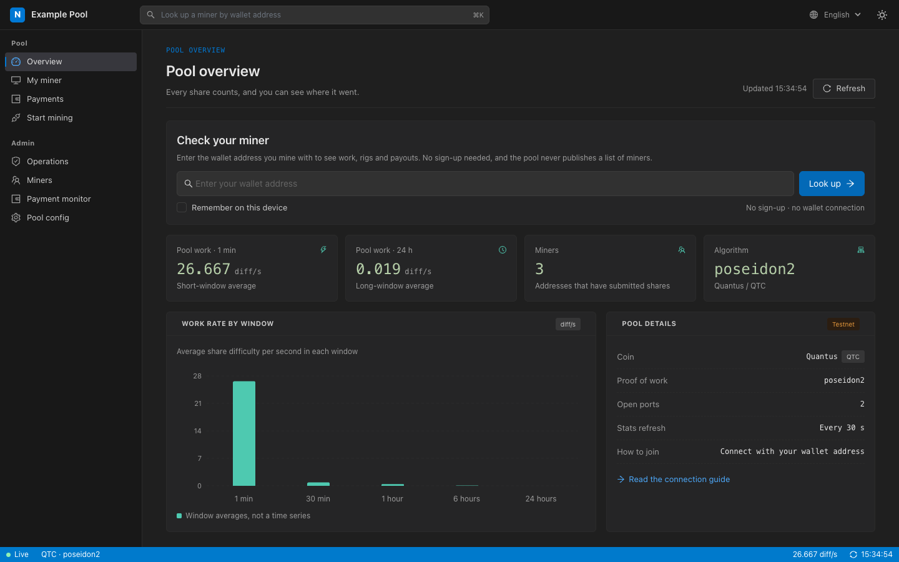
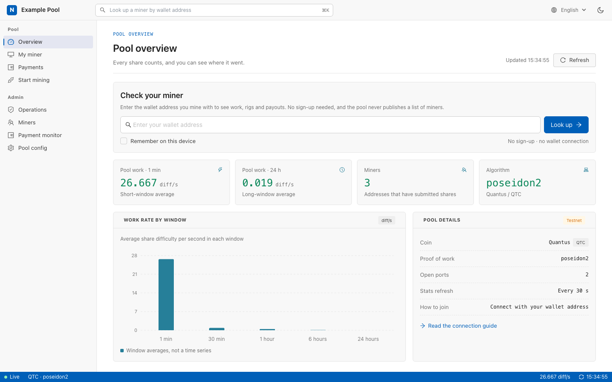
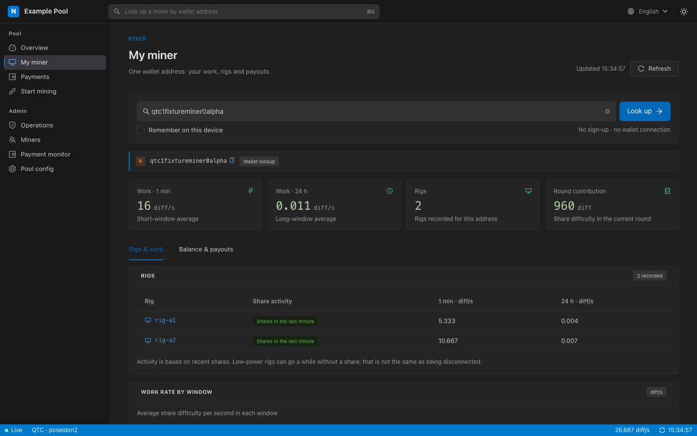
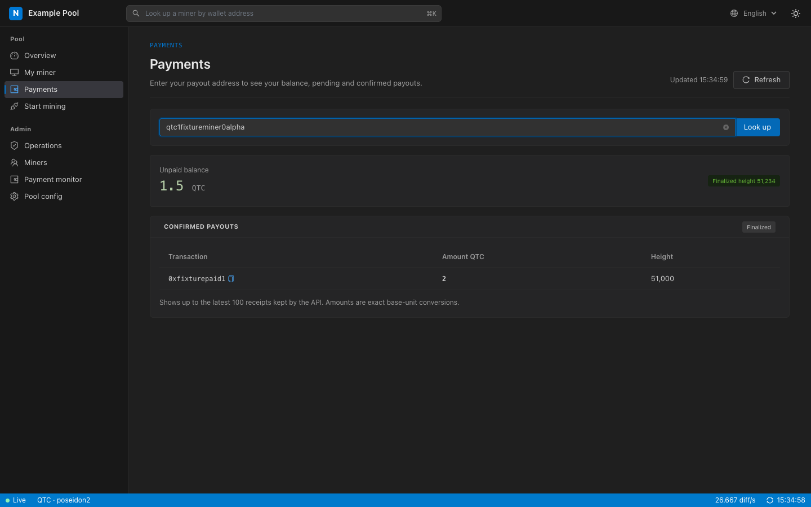
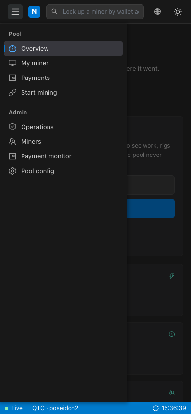

# NOMP pool webpage

English · [简体中文](README.zh-CN.md)

The web frontend for [Not-Only-Mining-Pool](https://github.com/mining-pool/not-only-mining-pool):
a React single-page app that miners use to check their rigs, work and payouts
with nothing but their wallet address, plus a read-only operations console for
pool administrators.

It is deployed on its own (any static host or the bundled Docker image) and
talks to the pool's JSON API. The look borrows VS Code's Dark/Light Modern
colours; English is the primary language, with Simplified Chinese available.



| Light theme | Miner | Payments | Mobile |
| --- | --- | --- | --- |
|  |  |  |  |

## Features

- **No accounts for miners.** Enter a wallet address to see work rates, rigs,
  round contribution, balance and payouts. Addresses are remembered only if the
  user opts in, and only in their browser.
- **Privacy by default.** The pool never publishes a miner list. Public pages
  show the miner count and pool-level payout data; a full address reveals only
  that address's records. The full index and ledger are admin-only, enforced by
  the API (see [Privacy](#privacy)).
- **Operations console** at `/admin` behind the Go server's administrator
  login (HttpOnly session cookie, CSRF token, rate limiting).
- **Languages:** English (default and fallback) and Simplified Chinese,
  detected from the browser and switchable in the top bar.
- **Light and dark themes**, responsive down to phones, keyboard shortcut
  `Ctrl/⌘ K` for the address search.
- **Production-ready hosting:** runtime configuration, strict Content Security
  Policy, SPA fallback, cache headers, health check and recovery after deploys.

## Pages

| Route | Purpose |
| --- | --- |
| `/` | Pool work rates by window, miner count, pool details, address lookup |
| `/miner/:address` | Rigs (paginated, with per-rig detail), contribution, balance and payouts |
| `/payments` | Pool payout status and settled blocks; a full address shows its own records |
| `/connect` | Coin, algorithm and ports with copyable miner settings |
| `/admin` | Operations overview: API health, payout errors, settled blocks |
| `/admin/miners` | Miner index (admin only) with per-address details |
| `/admin/payments` | Full payout ledger and pending transaction |
| `/admin/config` | Coin, algorithm and port configuration (read-only) |

## Quick start

Requires Node.js 22.12+ (24 LTS recommended).

```bash
git clone https://github.com/mining-pool/pool-webpage.git
cd pool-webpage
npm ci
npm run dev:demo      # built-in sample data, no pool needed
```

Demo mode is clearly labelled and is a build-time switch only: production
builds never fall back to sample data and it cannot be enabled at runtime.

### Develop against a pool

Run the pool API locally (see the backend's
[API guide](https://github.com/mining-pool/not-only-mining-pool/blob/master/docs/API.md#quick-start-local-development)),
with `api.allowedOrigins` containing `http://127.0.0.1:5173`, then:

```bash
cp .env.example .env.local
npm run dev           # http://127.0.0.1:5173
```

Vite proxies `/api/*` and `/admin-api/*` to `NOMP_API_TARGET`
(default `http://127.0.0.1:20000`). Without a real pool you can also run the
backend's test fixture, which serves the real API on an in-memory Redis:

```bash
cd ../not-only-mining-pool
NOMP_FIXTURE_ADMIN_PASSWORD=dev-password-123 \
  go run ./scripts/web-fixture -addr 127.0.0.1:20000 -origin http://127.0.0.1:5173
```

(sign in to `/admin` as `operator` with that password).

## Configuration

Settings are read at runtime from `/config.js`, falling back to build-time
`VITE_*` variables. Everything here is public — never put secrets in it.

| Runtime (`config.js` / Docker env) | Build-time | Default | Meaning |
| --- | --- | --- | --- |
| `apiBaseUrl` / `NOMP_API_BASE_URL` | `VITE_API_BASE_URL` | same origin | Pool API origin, e.g. `https://api.pool.example:20000` (no path) |
| `poolName` / `NOMP_POOL_NAME` | `VITE_POOL_NAME` | `NOMP Pool` | Name shown in the UI and page title |
| `stratumHost` / `NOMP_STRATUM_HOST` | `VITE_STRATUM_HOST` | page host | Host name miners connect to |
| — | `VITE_DEMO` | off | `true` only for `npm run dev:demo` |
| — | `NOMP_API_TARGET` | `http://127.0.0.1:20000` | Dev-server proxy target |

Invalid values are rejected (the browser logs an error; the Docker image
refuses to start).

## Deployment

### Docker

```bash
docker build -t pool-webpage .
docker run -d -p 8080:8080 \
  -e NOMP_API_BASE_URL=https://api.pool.example \
  -e NOMP_POOL_NAME="Example Pool" \
  -e NOMP_STRATUM_HOST=stratum.pool.example \
  pool-webpage
```

The image runs unprivileged nginx on port 8080 and:

- serves `/config.js` from the environment variables above, validated at start;
- falls back to `index.html` for client routes such as `/miner/:address`;
- caches content-hashed `/assets/*` for a year and revalidates `index.html`,
  so deploys take effect immediately;
- sends a Content Security Policy (scripts from this origin only, API calls
  only to `NOMP_API_BASE_URL`), `X-Content-Type-Options`, `X-Frame-Options`,
  `Referrer-Policy` and `Permissions-Policy`;
- answers `/healthz` for health checks.

Terminate TLS in front of it (load balancer or reverse proxy).

### Any static host

```bash
npm ci
npm run build         # output in dist/
```

Then, on your host:

1. Serve `dist/` and rewrite unknown paths to `/index.html`.
2. Replace `dist/config.js` with your settings, or build with `VITE_*` variables.
3. Cache `/assets/*` long-term; serve `index.html` and `config.js` with
   `no-cache`.
4. Recommended: the headers in
   [`deploy/nginx/security-headers.inc.template`](deploy/nginx/security-headers.inc.template).
   The app has no inline scripts, so `script-src 'self'` works; Ant Design
   needs `style-src 'unsafe-inline'`.

### Backend settings

On the pool API (`config.json`):

- `api.allowedOrigins` must list the site's exact origin, e.g. `https://pool.example`.
- Prefer a same-site API domain (`pool.example` + `api.pool.example`) so the
  default `SameSite=Strict` admin cookie works; cross-site deployments need
  `api.admin.cookieSameSite: "none"`.
- Serve the API over HTTPS (Go can do it directly with `api.tls`).

Details: [HTTP API guide](https://github.com/mining-pool/not-only-mining-pool/blob/master/docs/API.md).

## Privacy

- `/api/pool` returns `minerCount`, never the address list.
- `/api/payments` without an address returns pool-level data only; with
  `?address=` it returns only that address's balance and receipts.
- The full miner index and payout ledger are returned only to an administrator
  session via `/admin-api/*`.
- The frontend never renders lists of other miners outside the admin console,
  even against an older API that still sends them.

## Data conventions

- Work rates are the API's accepted share difficulty per second (`diff/s`),
  not device H/s, shown per window (1 min – 24 h) rather than as a time series.
- API responses are validated (Zod). Requests time out after 12 s; stats
  refresh every 30 s, payouts every 60 s, and polling pauses in hidden tabs.
  Failures keep the last good data and show when it was fetched.
- Amounts are converted from base-unit strings with BigInt — never floats.

## Languages

English is the source dictionary (`src/i18n/en.ts`); other languages implement
the same type, so a missing key fails the build. To add one, create
`src/i18n/<code>.ts` typed as `Messages`, register it in `src/i18n/index.tsx`
and add its Ant Design locale in `src/lib/theme.tsx`. API errors are translated
from their error codes, not from server text.

## Testing

```bash
npm run check         # TypeScript
npm test              # unit and component tests (Vitest, jsdom)
npm run e2e           # browser tests against the real Go API
```

`npm run e2e` builds the production bundle, serves it with the production
headers on `127.0.0.1:4173`, and starts the backend's `scripts/web-fixture`
(real API, storage, sessions and privacy rules on an in-memory Redis) from
`NOMP_REPO` (default `../not-only-mining-pool`). It covers live stats, miner
lookup, address-scoped payouts, the admin login/logout flow with cookies and
CSRF, language switching and runtime config, and fails on any console error or
CSP violation. Run `npx playwright install chromium` once, or set
`PLAYWRIGHT_CHANNEL=chrome` to use an installed Chrome.

CI runs formatting, type checks, unit tests and the build; the end-to-end suite
against the backend's `master`; and a Docker build with a smoke test of
routing, headers, caching and config validation.

## Project layout

```text
src/components/   page frame (top bar, navigation, status bar), shared UI
src/pages/        user pages and the admin console (lazy-loaded)
src/i18n/         dictionaries (en, zh) and language detection
src/lib/          API client, schemas, queries, formatting, theme, config
src/test/         jsdom setup and render helpers
e2e/              Playwright tests and the production-like static server
deploy/nginx/     nginx config, security headers and config validation
public/           boot.js (theme/language before paint) and default config.js
```
