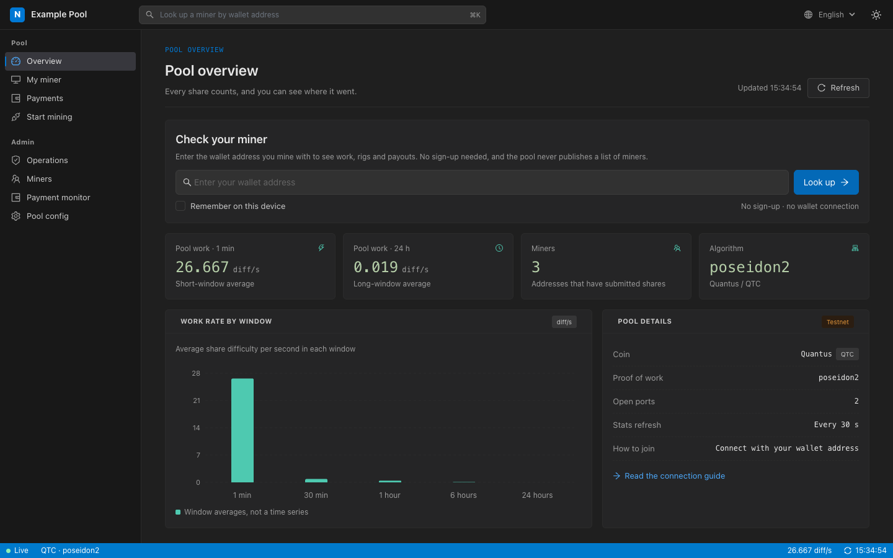

# NOMP 矿池网页

[English](README.md) · 简体中文

[Not-Only-Mining-Pool](https://github.com/mining-pool/not-only-mining-pool) 的网页前端：矿工只需钱包地址即可查看矿机、工作量和支付；管理员可使用只读运维控制台。

前端独立部署（任意静态托管或仓库自带的 Docker 镜像），通过矿池的 JSON API 获取数据。界面遵循 VS Code 风格：Dark / Light Modern 配色、直角、居中的命令中心式搜索。英文为主要语言，同时提供简体中文。



## 功能

- **矿工无需账户**：输入钱包地址即可查看工作量、矿机、本轮贡献、余额与支付。只有用户主动勾选时才会在本机浏览器记住地址。
- **默认保护隐私**：矿池不公开矿工名单。公开页面只显示矿工数量和矿池级支付信息；输入完整地址只能看到该地址自己的记录。完整索引和账本仅管理员可见，由 API 强制执行（见[隐私](#隐私)）。
- **运维控制台** `/admin`：使用 Go 后端的管理员登录（HttpOnly 会话 Cookie、CSRF token、登录限流）。
- **多语言**：英文（默认及兜底）和简体中文，按浏览器语言自动选择，可在顶部栏切换。
- **深浅色主题**，适配手机，`Ctrl/⌘ K` 快速聚焦地址搜索。
- **生产托管能力**：运行时配置、严格的内容安全策略（CSP）、SPA 路由回退、缓存头、健康检查、发布后自动恢复。

## 页面

| 路由 | 用途 |
| --- | --- |
| `/` | 各窗口工作量、矿工数量、矿池信息、地址查询 |
| `/miner/:address` | 矿机（分页及单机详情）、本轮贡献、余额与支付 |
| `/payments` | 矿池支付状态与结算区块；输入完整地址查看自己的记录 |
| `/connect` | 币种、算法、端口及可复制的矿机参数 |
| `/admin` | 运行概览：接口状态、支付异常、结算区块 |
| `/admin/miners` | 矿工索引（仅管理员）及单个地址详情 |
| `/admin/payments` | 完整支付账本与待处理交易 |
| `/admin/config` | 币种、算法、端口配置；无需重启即可重新加载 `config.json` |

## 快速开始

需要 Node.js 22.12+（推荐 24 LTS）。

```bash
git clone https://github.com/mining-pool/pool-webpage.git
cd pool-webpage
npm ci
npm run dev:demo      # 内置演示数据，无需矿池
```

演示模式会明确标注，且只能在构建时开启：生产构建不会回退到演示数据，也无法在运行时开启。

### 对接矿池开发

在本机运行矿池 API（见后端 [API 文档](https://github.com/mining-pool/not-only-mining-pool/blob/master/docs/API_zh.md#快速开始本机联调)），`api.allowedOrigins` 包含 `http://127.0.0.1:5173`，然后：

```bash
cp .env.example .env.local
npm run dev           # http://127.0.0.1:5173
```

Vite 将 `/api/*`、`/admin-api/*` 代理到 `NOMP_API_TARGET`（默认 `http://127.0.0.1:20000`）。没有真实矿池时，可运行后端的测试服务，它用内存 Redis 提供真实 API：

```bash
cd ../not-only-mining-pool
NOMP_FIXTURE_ADMIN_PASSWORD=dev-password-123 \
  go run ./scripts/web-fixture -addr 127.0.0.1:20000 -origin http://127.0.0.1:5173
```

（`/admin` 使用 `operator` 和该密码登录。）

## 配置

运行时从 `/config.js` 读取，未设置时回退到构建时的 `VITE_*` 变量。这些都是公开内容，不要放入任何密钥。

| 运行时（`config.js` / Docker 环境变量） | 构建时 | 默认 | 含义 |
| --- | --- | --- | --- |
| `apiBaseUrl` / `NOMP_API_BASE_URL` | `VITE_API_BASE_URL` | 同源 | 矿池 API origin，如 `https://api.pool.example:20000`（不带路径） |
| `poolName` / `NOMP_POOL_NAME` | `VITE_POOL_NAME` | `NOMP Pool` | 界面与页面标题中的名称 |
| `stratumHost` / `NOMP_STRATUM_HOST` | `VITE_STRATUM_HOST` | 当前网页域名 | 矿机连接的主机名 |
| — | `VITE_DEMO` | 关闭 | 仅 `npm run dev:demo` 使用 `true` |
| — | `NOMP_API_TARGET` | `http://127.0.0.1:20000` | 开发服务器代理目标 |

无效值会被拒绝（浏览器记录错误；Docker 镜像拒绝启动）。

## 部署

### Docker

```bash
docker build -t pool-webpage .
docker run -d -p 8080:8080 \
  -e NOMP_API_BASE_URL=https://api.pool.example \
  -e NOMP_POOL_NAME="Example Pool" \
  -e NOMP_STRATUM_HOST=stratum.pool.example \
  pool-webpage
```

镜像以非 root 的 nginx 监听 8080 端口：

- 启动时校验上述环境变量并生成 `/config.js`；
- `/miner/:address` 等前端路由回退到 `index.html`；
- 带内容哈希的 `/assets/*` 缓存一年，`index.html` 每次重新验证，发布立即生效；
- 发送 CSP（脚本仅限本站，API 请求仅限 `NOMP_API_BASE_URL`）、`X-Content-Type-Options`、`X-Frame-Options`、`Referrer-Policy`、`Permissions-Policy`；
- `/healthz` 用于健康检查。

TLS 请在前置的负载均衡或反向代理上终止。

### 任意静态托管

```bash
npm ci
npm run build         # 产物在 dist/
```

然后在托管平台上：

1. 托管 `dist/`，并把未知路径重写到 `/index.html`。
2. 用你的配置替换 `dist/config.js`，或构建时设置 `VITE_*` 变量。
3. `/assets/*` 长期缓存；`index.html`、`config.js` 使用 `no-cache`。
4. 推荐使用 [`deploy/nginx/security-headers.inc.template`](deploy/nginx/security-headers.inc.template) 中的响应头。应用没有内联脚本，`script-src 'self'` 可用；Ant Design 需要 `style-src 'unsafe-inline'`。

### 后端配置

矿池 API（`config.json`）中：

- `api.allowedOrigins` 必须包含本站的精确 origin，如 `https://pool.example`。
- 推荐使用同站点的 API 域名（`pool.example` + `api.pool.example`），默认 `SameSite=Strict` 的管理 Cookie 即可工作；完全跨站需设置 `api.admin.cookieSameSite: "none"`。
- API 使用 HTTPS（Go 可通过 `api.tls` 直接提供）。

详见 [HTTP API 文档](https://github.com/mining-pool/not-only-mining-pool/blob/master/docs/API_zh.md)。

## 隐私

- `/api/pool` 只返回 `minerCount`，不返回地址列表。
- `/api/payments` 不带地址时只返回矿池级数据；带 `?address=` 时只返回该地址的余额与回执。
- 完整矿工索引和支付账本只通过 `/admin-api/*` 返回给管理员会话。
- 即使对接仍返回名单的旧版 API，前端在管理控制台之外也不会渲染其他矿工的列表。

## 数据约定

- 算力（H/s；Equihash 类币种为 Sol/s）由 API 根据已接受份额估算，按窗口（1 分钟至 24 小时）以 SI 前缀（kH/s … EH/s）展示，不是时间序列，可能与矿机本地显示的数值不同。各引擎的换算方式见 API 文档。
- API 响应经 Zod 校验。请求 12 秒超时；统计每 30 秒、支付每 60 秒刷新，隐藏标签页暂停轮询。失败时保留上次成功的数据并显示获取时间。
- 金额以 BigInt 从最小单位字符串换算，不经浮点。

## 多语言

英文是源字典（`src/i18n/en.ts`），其他语言必须实现同一类型，缺少键会导致构建失败。新增语言：创建以 `Messages` 为类型的 `src/i18n/<code>.ts`，在 `src/i18n/index.tsx` 注册，并在 `src/lib/theme.tsx` 添加对应的 Ant Design 语言包。API 错误按错误码翻译，不使用服务端文案。

## 测试

```bash
npm run check         # TypeScript
npm test              # 单元与组件测试（Vitest、jsdom）
npm run e2e           # 对接真实 Go API 的浏览器测试
```

`npm run e2e` 会构建生产包，以生产响应头在 `127.0.0.1:4173` 托管，并从 `NOMP_REPO`（默认 `../not-only-mining-pool`）启动后端的 `scripts/web-fixture`（真实 API、存储、会话与隐私规则，使用内存 Redis）。覆盖实时统计、矿工查询、按地址的支付、带 Cookie 和 CSRF 的管理员登录 / 退出、语言切换和运行时配置；出现任何控制台错误或 CSP 违规即失败。首次运行请执行 `npx playwright install chromium`，或设置 `PLAYWRIGHT_CHANNEL=chrome` 使用已安装的 Chrome。

CI 执行格式检查、类型检查、单元测试和构建；对接后端 `master` 的端到端测试；以及 Docker 构建和对路由、响应头、缓存、配置校验的冒烟测试。

## 目录

```text
src/components/   页面框架（顶部栏、导航、状态栏）与通用组件
src/pages/        用户页面与管理控制台（懒加载）
src/i18n/         字典（en、zh）与语言检测
src/lib/          API 客户端、数据校验、查询、格式化、主题、配置
src/test/         jsdom 环境与渲染工具
e2e/              Playwright 测试与模拟生产的静态服务器
deploy/nginx/     nginx 配置、安全响应头与配置校验
public/           boot.js（首屏前应用主题和语言）与默认 config.js
```
